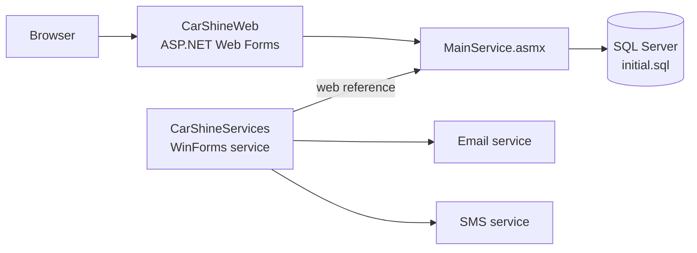

<div align="center">

# 🚗 CarShine

**Website and booking platform for a car-wash and detailing business, with background e-mail and SMS notifications.**

[](https://github.com/mr-aybee/car-shine-web/actions/workflows/ci.yml)


[](LICENSE)

</div>

---

## Overview

CarShine is a customer-facing site for a car-care business. Visitors browse services and the gallery, contact the business and book appointments online. Bookings flow through an ASMX web service into SQL Server, and the **CarShineServices** desktop service sends confirmation e-mails and SMS messages.

## Features

- 🏠 **Marketing pages** — home, about, gallery and contact
- 📅 **Online booking** for wash and detailing services
- 🔌 **ASMX web service** (`MainService.asmx`) for bookings and data access
- ✉️ **E-mail** and 📱 **SMS** notifications from a background service
- 🎨 Responsive Bootstrap (SCSS) front end

## Architecture



## Tech stack

| Component | Technology |
| --- | --- |
| Website | C# · ASP.NET Web Forms · .NET Framework 4.6 |
| Front end | Bootstrap (SCSS), jQuery |
| API | ASMX web service |
| Notifications | WinForms service with e-mail and SMS controllers |
| Data | SQL Server |

## Getting started

### Prerequisites

- Windows with Visual Studio 2019+ (ASP.NET and web development workload)
- SQL Server (Express or LocalDB)

### Setup

```shell
git clone https://github.com/mr-aybee/car-shine-web.git
cd car-shine-web
nuget restore CarShineWeb.sln
```

1. Create a `CarShine` database and run `initial.sql`.
2. Set the `dBCarShine` connection string in `CarShineWeb/Web.config` (replace `CHANGE_ME`; keep real credentials out of source control).
3. Open `CarShineWeb.sln`, set **CarShineWeb** as the startup project and run with IIS Express.

## Usage

- Customers browse **Services** and **Gallery**, then book on **Booking**.
- Bookings are stored through `MainService.asmx`.
- Run **CarShineServices** to send booking confirmations by e-mail and SMS (configure provider settings in its `App.config`).

## Project structure

```text
car-shine-web/
├── CarShineWeb/          # Web Forms site: Default, About, Gallery, Contact, Booking, Services/MainService.asmx
├── CarShineServices/     # Notification service: ServiceControllers/EmailService, SMSService
└── initial.sql           # Database schema
```

## Development

- Build with `msbuild CarShineWeb.sln`.
- CI builds the solution on Windows for every push and pull request.
- Use a disposable database and test mail/SMS accounts.

## Contributing

Contributions are welcome. Read [CONTRIBUTING.md](CONTRIBUTING.md) for the branch, build and pull-request workflow. Please report security issues privately through [GitHub security advisories](https://github.com/mr-aybee/car-shine-web/security/advisories/new), not public issues.

## Code of Conduct

This project follows the [Contributor Covenant](CODE_OF_CONDUCT.md). By participating you agree to uphold it.

## License

Released under the [MIT License](LICENSE). © 2026 Abdullah Shahid.
